# The banner that celebrates with you

← [Back to README](../README.md)

The Echo banner is alive. It floats on liquid glass, hums with an alien signal, and when a holiday is near it dresses up for it.

## The rules

- A decoration **starts 30 days before** the event.
- It stays up on the day.
- It **ends 2 days after**.
- If two events overlap, the nearest one wins.
- Everything is **per country**, using that country's own time zone, so a holiday on different dates in different places is always right for the person looking.

## Two ways to see it

| | How it knows your country |
|---|---|
| **[Live page](https://silentium-tech.github.io/echobot/)** | Reads your time zone in your browser, so you see *your* country's banner. It also plays the alien audio (tap the speaker). Add `?country=KE&date=2026-12-20` to preview any place and day. |
| **README banner** | GitHub shows one image to everybody, so a daily job rebuilds it for the home country (Uganda by default). Change the `BANNER_COUNTRY` repository variable to switch. |

## What it celebrates

| Theme | Events | Where |
|---|---|---|
| Christmas tree, snow | Christmas | Christian-majority and Christmas-observing countries |
| Fireworks and the new year number | New Year | Everywhere |
| Floating hearts | Valentine's Day | Everywhere |
| Eggs and petals | Easter (moves each year) | Easter-observing countries |
| Crescent, lanterns, stars | Eid al-Fitr and Eid al-Adha (follow the Islamic calendar) | Countries with large Muslim communities |
| Diyas and sparkles | Diwali | India, Malaysia, Singapore |
| Red lanterns | Lunar New Year | China, Vietnam, Korea, Singapore, Malaysia, Indonesia, Thailand |
| Pumpkin, bats, moon | Halloween | US, Canada, UK, Ireland, Australia, New Zealand, Philippines |
| Autumn leaves | Thanksgiving | US (fourth Thursday of November), Canada (second Monday of October) |
| Bonfire and fireworks | Bonfire Night | United Kingdom |
| Confetti and mask | Carnival | Brazil, Argentina |
| Sugar skull and marigolds | Día de Muertos | Mexico |
| Shamrocks | St Patrick's Day | Ireland, US, Canada |
| Water drops | Songkran | Thailand |
| **Flag colours, bunting, waving ribbons** | **National days** such as Uganda's Independence Day (9 October), Kenya's Jamhuri Day, Nigeria's Independence Day, India's Republic Day, Brazil's 7 September and many more | 45+ countries |

The Islamic dates are calculated with the Umm al-Qura calendar, so local moon sighting can move Eid by a day. Because decorations run for more than a month, that never matters visually.

## Gallery

| | |
|---|---|
| **Everyday** <br/> | **Christmas** <br/> |
| **New Year** <br/> | **Eid** <br/> |
| **Diwali** <br/> | **Lunar New Year** <br/> |
| **Halloween** <br/> | **National day (Uganda)** <br/> |
| **Valentine's Day** <br/> | **Easter** <br/> |
| **Thanksgiving** <br/> | **Bonfire Night** <br/> |
| **Carnival** <br/> | **Día de Muertos** <br/> |
| **St Patrick's Day** <br/> | **Songkran** <br/> |

## Run it yourself

```bash
node scripts/build-banner.js                      # today, home country
node scripts/build-banner.js --country KE         # Kenya
node scripts/build-banner.js --date 2026-12-20    # pretend it's that day
node scripts/build-banner.js --gallery            # rebuild the gallery above
```

`.github/workflows/banner.yml` runs this every day and commits the banner only when it changes. No dependencies, just Node 18 or newer.

## Add a country or an event

Everything lives in [`docs/banner-engine.js`](banner-engine.js):

- **A country:** add one line to the `C` table with its name, time zone, flag colours, the shared events it observes and its national days.
- **An event:** add an entry to `EVENTS` with a name, a theme, accent colours and a function that returns the date.
- **A theme:** add a scene in `SCENES`. It's plain SVG with animation, so anything you can draw will work.

Pull requests welcome. See [Contributing](../.github/CONTRIBUTING.md).
