<div align="center">



[English](../../README.md) · [Kiswahili](README.sw.md) · **Français** · [Español](README.es.md) · [Português](README.pt.md) · [العربية](README.ar.md) · [हिन्दी](README.hi.md) · [Bahasa Indonesia](README.id.md) · [Türkçe](README.tr.md) · [Русский](README.ru.md) · [中文](README.zh.md)

# WhatsApp, sans la corvée.

Echo est un bot WhatsApp qui gère vos groupes, télécharge vos médias, protège votre vie privée et répond en langage naturel, directement dans les conversations que vous utilisez déjà.

**[Démarrer en 1 minute](#start)** · [Tableau de bord](https://echowabot.vercel.app) · [Telegram](https://t.me/devaura_echobot) · [Toutes les commandes](../COMMANDS.md)

</div>

---

## Pourquoi on adopte Echo

- **Un téléphone plus léger.** Téléchargements, conversions et tâches d’IA tournent sur les serveurs d’Echo : votre téléphone garde sa batterie et son espace.
- **Des groupes qui se gèrent seuls.** Anti-lien, cartes de bienvenue, avertissements et validation des demandes d’adhésion. À régler une fois.
- **Des liens qui deviennent des fichiers.** Envoyez un lien TikTok, Reel, YouTube ou Spotify et le média arrive dans la conversation.
- **Parlez comme à une personne.** Dites à Oblivion ce qu’il vous faut, dans votre langue.
- **Rien ne disparaît.** Gardez les médias à vue unique, retrouvez les messages supprimés ou modifiés, refusez les appels indésirables.
- **Toujours en ligne.** Echo tourne 24 h/24 comme appareil associé, même quand votre téléphone se repose.

## Pensé pour les admins très occupés

- `.tagall`, `.hidetag` et `.tagcountry +256` pour mentionner les bonnes personnes
- `.antilink`, `.antiphish`, `.antibot`, `.antispam` pour protéger le groupe
- `.welcome on` pour accueillir chaque nouveau membre
- `.approve` et `.reject` pour traiter toutes les demandes d’un coup
- `.summarize` et `.timemachine today` pour rattraper la conversation

## Des téléchargements qui marchent

Envoyez un lien ou juste un titre. L’audio arrive avec une carte (pochette, titre, artiste).

```text
.play band for band
.spotify <link>
.tiktok <link>
.video <title>
```

## Oblivion, l’assistant d’Echo

Inutile de retenir des commandes. Écrivez naturellement : « Oblivion, ferme le groupe à 22 h » ou « Oblivion, décris cette image ».

<a id="start"></a>

## Démarrer en 1 minute

1. Ouvrez le bot Telegram et envoyez `/pair +votre numéro`.
2. Dans WhatsApp : **Paramètres → Appareils connectés → Associer un appareil → Associer avec le numéro de téléphone**, puis saisissez le code à 8 caractères.
3. Envoyez `.menu` dans n’importe quelle conversation.

## Pour aller plus loin

Documentation complète (en anglais) : [Commandes](../COMMANDS.md) · [Fonctionnalités](../FEATURES.md) · [Guide des admins](../ADMIN-GUIDE.md) · [FAQ](../FAQ.md) · [Confidentialité](../PRIVACY.md)

---

Echo est créé par **Benjamin** (Dev Aura, loner_01verified), un jeune développeur ougandais, sous Silentium Techies™.

<div align="center">
<sub>Echo est un projet indépendant, sans lien avec WhatsApp ou Meta.<br/>Echo · v10 · <a href="https://echowabot.vercel.app">echowabot.vercel.app</a></sub>
</div>
